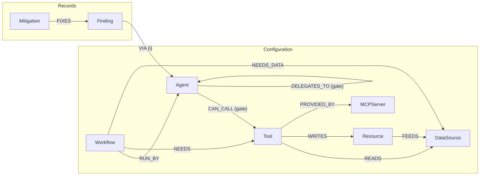
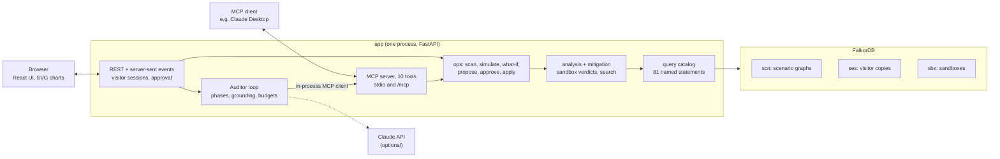

# Cistern

Cistern finds the paths by which untrusted text can reach a high-impact action in a system of AI agents, shows each one hop by hop, and finds the smallest change to the configuration that closes it without breaking the work the agents are there to do. It models agents, MCP tools, data sources and resources as a graph in [FalkorDB](https://www.falkordb.com/). Every finding and every verdict on a fix is a graph query, and every fix is tested in a throwaway copy of the graph before a person is asked to approve it.

Built for **Graph Hacks: Context for AI Agents** (WeMakeDevs × FalkorDB), **Track 01, Agents That Act on Connected Data**.

Three things to know before reading further:

- **The auditor runs with a model when a key is set, and without one otherwise.** Until the evening of 13 October no API key was available, so everything was built and checked with *scripted* runs: the same loop and the same tools, with a fixed search choosing the steps. With the key, the model (Claude Opus 5.5) drove runs on every scenario and matched the baseline's plan each time, in fewer sandboxes; the numbers are under [The auditor](#the-auditor). The UI says on every run which kind it was.
- **There is no live deployment yet.** Everything runs locally with one command. [Deployment](#deployment) says what is ready.
- **All of it was written before the event opened.** See [What was written before the event](#what-was-written-before-the-event).

## Contents

- [What it does](#what-it-does)
- [What FalkorDB does here](#what-falkordb-does-here)
- [Run it](#run-it)
- [A tour in five minutes](#a-tour-in-five-minutes)
- [The graph data model](#the-graph-data-model)
- [How a finding is found and a fix is judged](#how-a-finding-is-found-and-a-fix-is-judged)
- [The queries and algorithms](#the-queries-and-algorithms)
- [Architecture](#architecture)
- [The auditor](#the-auditor)
- [Use it from an MCP client](#use-it-from-an-mcp-client)
- [Scenarios and data](#scenarios-and-data)
- [Tests](#tests)
- [Deployment](#deployment)
- [What is not built](#what-is-not-built)
- [What was written before the event](#what-was-written-before-the-event)
- [How AI tools were used](#how-ai-tools-were-used)
- [Design credits](#design-credits)
- [Layout](#layout)

## What it does

An agent that reads a customer ticket and can also issue a refund is one prompt injection away from issuing the wrong refund. Whether that is possible is a question about the configuration: which agent may call which tool, who delegates to whom, what each tool reads and what it acts on. Cistern answers it from the graph of that configuration.

1. **Scan.** Seven rules turn the configuration into a second layer of edges that say where text and data can flow. Two graph queries over that layer find every *injection path* (an untrusted source reaches a high-impact resource) and every *lethal trifecta* (one agent is reached by untrusted text and by private data, and can reach a way out of the organisation).
2. **Explain.** Each finding comes with its path, hop by hop, each hop naming the rule that made it and the config edge behind it. A third kind of finding, *manifest drift*, has no path: a server's tool definitions are not the ones loaded before, and the finding stands until a person accepts them. The longest in the bundled scenarios is eleven hops, through three agents, a push to a branch and a deploy.
3. **Look for a fix.** Candidate fixes come from the config edges the path crosses. Five kinds exist: gate a call behind a person, revoke a grant, quarantine what a delegate returns, stop a tool reading a source, split an agent so a quarantined reader does its reading.
4. **Test it.** Each candidate is applied to a copy of the graph. The same queries run again, and a plan passes only if the finding it targets is gone, no new finding has appeared, and every workflow still has what it needs. A plan that fails says why: "breaks wf:refund-request: nothing on its path can read src:customer-tickets any more".
5. **Wait for a person.** The cheapest plan that passed is put in front of a person. Nothing changes the graph until they approve, and no tool can approve.

## What FalkorDB does here

Without FalkorDB, Cistern cannot compute a path, rank a chokepoint or verify a fix. It is the only store, and the work is done inside it:

| What | How |
| --- | --- |
| The flow layer | One atomic Cypher statement, `projection.rebuild`, derives every `FLOWS_TO` and `GATED_FLOW` edge from the config edges |
| Injection paths and trifectas | `algo.bfs` from each untrusted or private source, to a depth equal to the node count, so no path is too long to find |
| The evidence for a finding | `algo.SPpaths` between one source and one sink, fewest hops first |
| What a chart fills in | `algo.bfs` from every untrusted source (`reach.untrusted_nodes`); the page colours the answer and works nothing out itself |
| Trust zones and communities | `algo.WCC` over the flow layer; `algo.labelPropagation` over the config edges |
| Influence | `algo.pageRank` over the flow layer, on every node's read panel |
| The Rule of Two | Three BFS passes per scenario: which agents untrusted input reaches, which private data reaches, which can act |
| Central agents and tools | `algo.betweenness` |
| The cheapest cut | `algo.maxFlow`, with each hop's capacity set to the cost of the cheapest fix that cuts it |
| Sandboxes | `GRAPH.COPY`: a fix is tested on a copy, which is then deleted; there is no other way a sandbox is made |
| Visitor isolation | `GRAPH.COPY` again: the first change a visitor makes is made to their own copy of the scenario |
| Read-only safety | Every read is sent with `GRAPH.RO_QUERY`, so the server refuses a write in it |

The compose file pins `falkordb/falkordb:6.0.2`. The test suite passes on it and on `v4.22.0`.

## Run it

You need Docker and `make`. To run from source you also need [uv](https://docs.astral.sh/uv/), Node 20 or newer, and Google Chrome for the browser tests.

```bash
cp .env.example .env        # then set FALKORDB_PASSWORD
make app                    # FalkorDB 6.0.2 and the app, in containers
```

Open <http://localhost:8000>: a landing page, with the app behind "Open the app" (or at `#/acme_support`) and your own config behind "Paste your config" (`#/acme_support/import`). The app loads the four scenarios on first start, scans each, and audits each to its first proposal, scripted, so the first screen already holds tested plans waiting for a nod. `PRERUN_AUDITS=false` skips that pass.

From source, for development:

```bash
make up                     # FalkorDB only, on localhost:6380 (its Browser on localhost:3000)
make seed                   # load scenarios/*.yaml and scan each against its own expect block
make test                   # the whole suite, against the running FalkorDB
make serve                  # build the UI and run the app on http://localhost:8000
make e2e                    # drive the running app in headless Chrome (needs Google Chrome)
```

`make seed` prints what it found:

```text
acme_dev: 27 nodes, 34 config edges, 4 injection and 3 trifecta findings in 31 ms
acme_exec: 12 nodes, 13 config edges, 0 injection and 2 trifecta findings in 18 ms
acme_support: 15 nodes, 14 config edges, 1 injection and 0 trifecta findings in 8 ms
  fnd:dce0910d42 injection: src:customer-tickets -> tool:helpdesk.get_ticket -> agent:support-bot -> tool:payments.issue_refund -> res:payments-api
cistern_self: 19 nodes, 36 config edges, 0 injection and 0 trifecta findings in 5 ms
```

Other targets: `make probe` checks the FalkorDB behaviours the design depends on, `make dev` runs the app with reload beside the Vite dev server, `make mcp` runs the MCP server over stdio, `make mcp-config` prints the entry for an MCP client's config file, `make queries-doc` rewrites [docs/QUERIES.md](docs/QUERIES.md), `make self-manifest` rewrites the manifest Cistern audits itself with, and `make agent-eval` compares the auditor with the baseline search.

To let a model drive the auditor, put `ANTHROPIC_API_KEY` in `.env`. `.env.example` lists the other settings: the model, a daily spend ceiling, a bearer token for `/mcp`, the session limits, and the hosted mode. `CISTERN_PUBLIC=true` is the setting for a public address: the import takes only what is pasted and launches nothing, nothing is ever written to a file, imports and runs are rationed per address, visitor copies are dropped past a FalkorDB memory ceiling, and the app waits for the database at start instead of starting empty. The host port for FalkorDB is 6380, not 6379, because many machines already run a Redis there.

## A tour in five minutes

The sidebar is in four groups: **Findings** (Inbox, Done), **Fixes** (Ledger, What if), **System** (Graph, Servers, Queries) and **Audit** (Runs, Import). The switch at its top changes scenario. A finding is worked through in three steps, **Problem**, **Fix** and **Options**, with the run's **Trace** beside them. Every chart has two renderers: Cistern's own, laid out by ELK and drawn with React Flow, and FalkorDB's canvas component on the same nodes; the switch over each chart remembers your choice. Anything you change is changed in your own copy of the scenario; the arrow at the foot of the sidebar gives you the original back.

1. **Acme support desk → Inbox.** One finding: customer tickets can reach the payments API. The audit the app ran at start has already tested fixes for it in sandbox graphs: both revokes fail (the refund workflow needs those tools), stopping the tool reading tickets fails for the same reason, the gate passes and so does a split. The row reads "Awaiting nod" and carries its OWASP class. Open it.
2. **Step 1, the problem.** The brief says how in one paragraph with numbered evidence; the chart draws the four hops as cards in lanes, with the hop the fix would cut marked; "Whole system" draws everything around them, and "FalkorDB canvas" draws the same nodes on FalkorDB's own component. The hop table folds out under the chart with the rule and the config edge behind each hop, and the analysis under that reads the agents on the path against Meta's Rule of Two, names the workflows that constrain a fix, and gives the OWASP class.
3. **Step 2, the fix.** The plan that passed, change by change, and the path as the plan would leave it, read from a sandbox. In the bar, "see the change to the scenario file" shows the plan as a diff of `scenarios/acme_support.yaml`: `gate: human_approval` on one line, comments kept. The text can be edited. **Approve · Apply** changes the graph; tick "Also write it" and it writes the file too, with a backup beside it, reloads the scenario from the file, and the finding closes on the reload or stays open with the receipt saying so. On an imported Claude Code project the same panel shows an `ask` rule for `.claude/settings.json`.
4. **Step 3, the options.** Every plan a sandbox was asked about for this finding, cheapest first, passed or not, with the reason; a passing one can be previewed. Under them the what-if line, the cheapest cut as rules, the servers on the path and what a sandbox says removing one would do, and, with a model, a rehearsal of what an attacker would plant.
5. **Reject the gate** with a reason, such as "refunds must stay automatic". The bar offers the other plan that passed: split the support bot, so a reader does the reading and returns only structured fields. **Approve · Apply.** The finding closes, and the chart shows the reader and the quarantined hop.
6. **Fixes → Ledger** is every plan a sandbox was asked about, across findings, with its verdict and the literal change; select a plan to see the finding's path as that plan would leave it. **Fixes → What if** tests a change that widens the config: on *Acme dev team*, "Release bot could call request" opens one new finding; under it, the cheapest cut as a Claude Code `permissions` block and Docker MCP Gateway commands.
7. **Acme executive office.** Here the gate fails, because the daily digest runs unattended and nobody is there to approve; the audit proposes quarantining the inbox reader instead, and that closes two findings at once.
8. **Acme dev team.** Seven findings, closed by two fixes in two rounds. One finding is the eleven-hop path: an issue is read by the triage agent, handed to the planner and the coder, pushed to the main branch, read back from the repository by the release bot, and deployed.
9. **System → Graph.** The overview: untrusted sources on the left, the agents they reach in the middle, the high-impact actions on the right, and only the open paths drawn between them, as sankey ribbons whose width grows with the number of routes. The title is a sentence read from the graph, each agent carries its Rule of Two letters, and the counts strip gives the cheapest cut's cost by `algo.maxFlow`. "All nodes" draws everything as cards in lanes, on Cistern's chart or on FalkorDB's canvas (force or tree); "More" holds the layers, Communities, Most central, the Cheapest cut and the edges as a table.
10. **Graph → More → Cheapest cut.** `algo.maxFlow` marks the cheapest set of hops that separates every untrusted source from every high-impact resource, and shows the cut as a Claude Code `permissions` block and as Docker MCP Gateway commands. On the support desk the cut is one revoke, which the sandbox refuses: the cut says where to look, the sandbox says what is safe.
11. **Cistern itself.** Cistern's own MCP tools, loaded as a scenario. Nothing is open, and only because `apply_fix` needs a person: take that gate away and two injection paths open.
12. **Graph → More → Communities** colours the cards' edges by `algo.labelPropagation` over the config edges; **Most central** rings the five agents and tools the most flow passes through, by `algo.betweenness`; clicking an agent shows its PageRank and its Rule of Two badges.
13. **Inbox → Rule of Two.** Under the findings, a scorecard: for each agent, whether untrusted input reaches it, whether private data does, and whether it can act. On the executive office the assistant holds all three and runs unattended, which Meta's rule says it must not.
14. **System → Servers.** Each MCP server with its tools, who holds them and the findings that run through them, and "test removing it": a sandbox says what taking the server out would close and break. On the dev team, removing the HTTP server closes five findings and breaks nothing.
15. **Audit → Runs, the ask box.** Without a model the graph answers four kinds of question by itself: try "What can reach Payments API?" The answer names the query it came from, and the trace shows it as a step.
16. **System → Queries.** Every chart note and every finding links to the query behind it, and the nav row opens the whole catalogue; either opens a drawer with the Cypher over the page you are on (`#/<scenario>/queries/<name>`), and Escape closes it. Nothing in the app runs a query that is not in that list.
17. **Audit → Import.** The switch's last entry, or "Paste your config" on the landing page: paste a client config or a saved `tools/list`, say what is untrusted and what matters, and the audit runs by itself to its first proposal. See [Import your own install](#import-your-own-install).

## The graph data model

One FalkorDB graph per scenario (`scn:<name>`), with three kinds of content: the configuration a person set up, a flow layer derived from it, and the records of what was found and decided.



**Nodes**

| Label | Properties | What it is |
| --- | --- | --- |
| `Agent` | `id`, `name`, `owner` | An AI agent |
| `Tool` | `id`, `name`, `server_id`, `description`, `capability` (`read`, `write`, `exfil`, `exec`, `unknown`), `capability_source` | One MCP tool, from a server's `tools/list` |
| `MCPServer` | `id`, `name`, `source_url`, `synthetic` | Where a tool comes from |
| `DataSource` | `id`, `name`, `trust` (`untrusted`, `internal`, `private`) | Something a tool reads. *Untrusted* means people outside the organisation can write it |
| `Resource` | `id`, `name`, `impact` (`high`, `medium`, `low`), `external` | Something a tool acts on. *External* means it leaves the organisation |
| `Workflow` | `id`, `name`, `description`, `mode` (`supervised`, `autonomous`) | Work the agents must keep being able to do |
| `Finding` | `fingerprint`, `id`, `kind`, `severity`, `status`, `source_id`, `target_id`, `agent_id`, `path_ids`, `evidence_json`, timestamps | An injection path or a trifecta agent, kept across scans |
| `Mitigation` | `id`, `status`, `fix_json`, `cost`, `passed`, `reason`, `verdict_json`, `config_hash`, `target_fingerprints`, `source`, `rationale`, who decided and when | A plan and the sandbox verdict on it |
| `Scan` | `scan_id`, `at`, `duration_ms`, counts | The last scan of the graph |
| `ToolAct` | `id`, `of`, `name` | Derived, never loaded or drawn: the acting side of a tool that writes (see below) |

Ids carry their kind: `agent:support-bot`, `tool:payments.issue_refund`, `src:customer-tickets`, `res:payments-api`, `wf:refund-request`, `srv:payments`, `fnd:dce0910d42`, `mit:b68c44c5ab`. A finding's id is the first ten hex digits of a hash of what it is (source and sink, or the agent), so the same finding has the same id on every scan and in every copy.

**Config edges**

| Edge | Meaning | Properties |
| --- | --- | --- |
| `(Agent)-[:CAN_CALL]->(Tool)` | The agent holds a grant for the tool | `gate`: `human_approval` when a person must approve each call; `origin` |
| `(Agent)-[:DELEGATES_TO]->(Agent)` | The first hands work to the second | `gate`: `quarantine` when only structured fields come back; `origin` |
| `(Tool)-[:READS]->(DataSource)` | The tool returns content from the source | |
| `(Tool)-[:WRITES]->(Resource)` | The tool acts on the resource | |
| `(Resource)-[:FEEDS]->(DataSource)` | What is written to the resource is later read as the source | |
| `(Workflow)-[:RUN_BY]->(Agent)`, `[:NEEDS]->(Tool)`, `[:NEEDS_DATA]->(DataSource)` | What a workflow requires | |
| `(Tool)-[:PROVIDED_BY]->(MCPServer)` | Provenance | |

**The flow layer: seven rules.** `projection.rebuild` deletes and rewrites these edges in one statement, so a reader never sees half a layer.

| Rule | Derived edge | From | In words |
| --- | --- | --- | --- |
| 1 | `(DataSource)-[:FLOWS_TO]->(Tool)` | `READS` | A tool returns what it reads |
| 2 | `(Tool)-[:FLOWS_TO]->(Agent)` | `CAN_CALL` to a tool that reads | What a tool returns enters the context of the agent that called it |
| 3 | `(Agent)-[:FLOWS_TO]->(ToolAct)` | `CAN_CALL` to a tool that writes | An agent's context decides the calls it makes |
| 4 | `(Agent)-[:FLOWS_TO]->(Agent)` | `DELEGATES_TO` | Context passes down to a delegate |
| 5 | `(ToolAct)-[:FLOWS_TO]->(Resource)` | `WRITES` | A tool acts on its resource |
| 6 | `(Agent)-[:FLOWS_TO]->(Agent)`, delegate to delegator | `DELEGATES_TO` | A delegate's results come back |
| 7 | `(Resource)-[:FLOWS_TO]->(DataSource)` | `FEEDS` | What was written is read back later: stored taint |

A gate does not remove a grant; it removes the flow. A gated `CAN_CALL` yields `GATED_FLOW {rule: 3}` in place of the rule 3 edge, and a quarantined delegation yields `GATED_FLOW {rule: 6}`. The verdict queries traverse `FLOWS_TO` only, so a gated hop stops a path, and the UI can still draw it as blocked. Gates cut only rules 3 and 6 because those are the two places a person or a schema can stand between text and its effect: a person can approve a call, and a quarantine can restrict what comes back. Reading (rules 1 and 2), passing context down (4), a tool doing what it does (5) and stored data being read again (7) have nobody in the loop.

Each `FLOWS_TO` edge also carries `capacity`: the cost of the cheapest fix that can cut it, or 1000 where no fix can. That is what `algo.maxFlow` runs on.

A tool that writes has two sides in this layer. What it reads leaves its `Tool` node toward its callers (rules 1 and 2); a call enters a separate `ToolAct` node and leaves only toward the resource (rules 3 and 5). With one node, an agent's context would flow through a tool into every other agent that calls it, which is not something that happens. The acting side is made by the same statement as the edges and named by its tool in every query that reads the layer, so a path still reads `agent → tool → resource`.

The model still over-approximates on purpose: a path means text *can* flow, not that it did.

## How a finding is found and a fix is judged

Three read-only queries decide every verdict. They are the whole definition of "safe" in this product.

```cypher
// reach.untrusted_to_high: which high-impact resources each untrusted source reaches
MATCH (s:DataSource {trust:'untrusted'})
CALL algo.bfs(s, $max_depth, 'FLOWS_TO') YIELD nodes
UNWIND nodes AS n
WITH s, n WHERE 'Resource' IN labels(n) AND n.impact = 'high'
RETURN s.id AS source, collect(DISTINCT n.id) AS targets
```

```cypher
// find.trifecta: agents reached by untrusted and by private data that can reach a way out
MATCH (d:DataSource) WHERE d.trust IN ['untrusted', 'private']
CALL algo.bfs(d, $max_depth, 'FLOWS_TO') YIELD nodes
UNWIND nodes AS a
WITH d, a WHERE 'Agent' IN labels(a)
WITH a,
     collect(DISTINCT CASE WHEN d.trust = 'untrusted' THEN d.id END) AS untrusted,
     collect(DISTINCT CASE WHEN d.trust = 'private' THEN d.id END) AS private_data
WHERE size(untrusted) > 0 AND size(private_data) > 0
CALL algo.bfs(a, $max_depth, 'FLOWS_TO') YIELD nodes
UNWIND nodes AS x
WITH a, untrusted, private_data, x WHERE 'Resource' IN labels(x) AND x.external = true
RETURN a.id AS agent, untrusted, private_data, collect(DISTINCT x.id) AS exits
```

```cypher
// wf.broken: anything a workflow needs that the config no longer gives it
MATCH (w:Workflow)-[:RUN_BY]->(a:Agent), (w)-[:NEEDS]->(t:Tool)
OPTIONAL MATCH (a)-[:DELEGATES_TO*0..3]->(:Agent)-[c:CAN_CALL]->(t)
WITH w, t, count(c) AS grants, sum(CASE WHEN c IS NOT NULL AND c.gate IS NULL THEN 1 ELSE 0 END) AS ungated
WHERE grants = 0 OR (w.mode = 'autonomous' AND ungated = 0)
RETURN w.id AS workflow, 'tool' AS kind, t.id AS missing, w.mode AS mode, grants > 0 AS gated
UNION
MATCH (w:Workflow)-[:RUN_BY]->(a:Agent), (w)-[:NEEDS_DATA]->(d:DataSource)
OPTIONAL MATCH p = (a)-[:DELEGATES_TO*0..3]->(:Agent)-[:CAN_CALL]->(:Tool)-[:READS]->(d)
WITH w, d, count(p) AS ways
WHERE ways = 0
RETURN w.id AS workflow, 'data' AS kind, d.id AS missing, w.mode AS mode, false AS gated
```

`$max_depth` is the node count of the graph, so the search is exhaustive. The paths a finding shows come from a separate query, `evidence.pair_paths` (`algo.SPpaths`), which never decides anything: a finding exists because the verdict query says so, and the path is how it is explained.

**A verdict.** To judge a plan, Cistern copies the graph (`GRAPH.COPY`), applies the plan's fixes to the copy, rebuilds the flow layer, runs the three queries, and compares with the same three queries on the original. The plan passes if every finding it targets is gone, no finding exists that did not before, and no workflow is broken that was not before. Then the copy is deleted. A supervised workflow can live with a gate, because someone is there to approve; an autonomous one cannot, and that difference is what makes the right fix depend on the graph.

**The fixes.** Cost orders the search; it is a preference, not a measurement.

| Fix | Cost | What it changes | What it cuts |
| --- | ---: | --- | --- |
| `revoke_call` | 1 | Deletes a grant | Rule 2 and rule 3 for that agent and tool |
| `gate_call` | 2 | A person must approve each call | Rule 3 |
| `quarantine_delegation` | 2 | A delegate returns only structured fields | Rule 6 |
| `drop_read` | 3 | A tool stops reading a source | Rule 1 |
| `split_agent` | 4 | A new reader agent takes the agent's reading tools, and its results come back quarantined | Rule 2 into the agent |

A plan is one to three fixes; each fix after the first adds a point. The baseline search tries single fixes cheapest first and pairs only if no single fix passes, within a budget of twenty sandboxes. Revoking is cheapest because removing a grant nothing needs is least privilege; the workflow check is what stops it when something does need the grant. A split only moves tools whose capability is known to be `read`, and its verdict catches the case where the reader itself would become a trifecta.

**Where it sits in the OWASP list.** Each finding names its class in the OWASP Top 10 for Agentic Applications, on its row and in its brief: an injection path is ASI01 (goal hijack) and ASI02 (tool misuse); a trifecta is ASI03 (identity and privilege abuse) and ASI02; manifest drift is ASI04 (agentic supply chain); a poisoned description is ASI04 and ASI01.

**What-if** runs the same comparison for a change that widens the config (`grant_call`, `add_delegation`), and never leaves the sandbox.

**Applying.** A plan that passed is stored as a `Mitigation` with the hash of the config it was verified against. A person approves or rejects it by name. On apply, if the config has changed since the verdict, the plan is verified again first; if its finding is already gone, it is refused as stale. The fix queries are guarded in the client: on a scenario graph they run only through the apply step, never from a tool call.

## The queries and algorithms

Every Cypher statement the product runs is a named entry in [`cistern/graph/catalog.py`](cistern/graph/catalog.py), sent with parameters and never built from strings. There are 63. **[docs/QUERIES.md](docs/QUERIES.md) is the full list with the Cypher of each**, generated from the catalog (a test fails if it is out of date). The app serves the same list at `/api/queries`.

| Group | Queries | Purpose |
| --- | --- | --- |
| Verdict | `reach.untrusted_to_high`, `find.trifecta`, `wf.broken` | Decide what is a finding and whether a plan passes |
| Projection | `projection.rebuild`, `flow.edges`, `flow.gated_edges` | The seven rules |
| Evidence | `evidence.pair_paths`, `node.names`, `graph.node_count` | Paths to show, never to decide |
| Algorithms | `zones.wcc`, `choke.betweenness`, `choke.maxflow` | Trust zones, central nodes, the cheapest cut |
| Fixes and what-if | `fix.gate_call`, `fix.revoke_call`, `fix.quarantine_delegation`, `fix.drop_read`, `fix.split_agent`, `whatif.grant_call`, `whatif.add_delegation` | Each one statement that reports how many rows it changed |
| Records | `finding.*`, `mitigation.*`, `scan.*` | Findings, plans, verdicts, decisions |
| Loading | `ingest.*`, `schema.index.*`, `config.*` | Scenario files to graph; the config hash; cloning without `GRAPH.COPY` |
| UI and self-check | `ui.*`, `scenario.summary`, `canary.*` | What the charts read; a known-bad graph scanned at start |

FalkorDB procedures used: `algo.bfs`, `algo.SPpaths`, `algo.WCC`, `algo.betweenness`, `algo.maxFlow`. Commands beyond `GRAPH.QUERY`: `GRAPH.RO_QUERY`, `GRAPH.COPY`, `GRAPH.DELETE`, `GRAPH.LIST`.

The cheapest cut is read off the max flow in Python: the edges that leave the part of the graph still reachable from the sources once every saturated edge is removed. It is offered as a guide and labelled as one. It knows nothing about workflows, one revoke removes two flow edges, and a trifecta is not a cut.

## Architecture



- **One path to the graph.** The UI's routes and the MCP tools call the same functions in `cistern/ops.py`. The auditor is itself an MCP client of the same server, so what it can do is exactly what any MCP client can do.
- **Approval lives in one place.** A person approves through the API, by name. There is no MCP tool for it, and the model is never offered one.
- **A file is written only by a person.** The MCP tool `apply_fix` changes the graph and nothing else. The file a scenario came from is written by a click in the review panel, after the diff has been read, or by `python -m cistern.apply --yes` typed at a prompt. A public site never writes a file.
- **Three kinds of graph, told apart by key.** `scn:` is a scenario, `ses:<session>:` is one visitor's copy, `sbx:` is a sandbox. The client refuses a write that the key does not allow: an analysis query cannot write, a fix cannot touch a scenario graph outside apply, and a what-if change can only ever run on a sandbox.
- **Events.** Scans, findings, proposals, decisions and every step of an audit run go to the browser over one server-sent event stream.
- **Self-check.** At start, and on each health check, a small graph with a known injection and a known trifecta is built and scanned; if FalkorDB stops finding them, `/api/health` says so.

## The auditor

An audit run moves through phases: scan, investigate, mitigate, wait for approval, apply, report. In each, the model is offered only the tools that phase allows, and decides for itself which to call. Around it, the loop enforces four things:

- **Every tool call says why.** A `because` argument names the earlier result that makes this the next call, and it is shown in the trace.
- **Grounding.** Any id the model writes (`agent:…`, `fnd:…`, `mit:…`) must have appeared in a tool result of the same run. An ungrounded `because` fails the call with an error the model can correct; an ungrounded report is asked for once more, then replaced by a templated one.
- **Untrusted text is marked.** Tool names and descriptions from manifests reach the model inside `<untrusted>` blocks they cannot close.
- **Budgets.** At most 8 model steps per phase and 40 per run, 8 simulations per target, and a daily spend ceiling.

**Scripted mode.** With no API key, or if the provider fails, the run continues without a model from the phase it is in: find the paths, read the trust zones and the cheapest cut by max flow, take the most severe finding, run the baseline search, propose the cheapest plan that passed, wait for a person, apply, report from a template (which says what the cut cost beside what the plan cost). Every step records who decided it (`model`, `loop`, `scripted` or `person`), and a scripted run is never presented as the model's.

**Runs nobody clicked.** At start the app runs this scripted pass on every shared scenario that has open findings and no tested plan, stopping at the proposal, so that the first screen a visitor sees holds tested plans and no model is spent on it. An audit that follows an import, a labelling, or an applied plan that leaves other findings open runs the same way, with the model if one is configured and the visitor has runs left; so does the one that follows a written file, scripted, on the shared scenario the file now makes. Each run ends with one JSON line in the log: who drove it, its steps, sandboxes and estimated cost.

**State of this, plainly.** The loop, the phases, grounding and the fallback are tested with a scripted stand-in for the model (41 tests), and the Claude adapter with the SDK call stubbed. The model itself was first run on the evening of 13 October, with `claude-opus-5-5`. `make agent-eval` takes the baseline search's best plan for each scenario as the yardstick, runs the auditor to its proposal three times on fresh copies, and reports what it proposed, the sandboxes it used, its model steps and the estimated spend. Its first table:

| Scenario | Baseline plan (cost, sandboxes) | The model proposed | Sandboxes | Model steps | Est. USD |
| --- | --- | --- | ---: | ---: | ---: |
| `acme_support` | gate the refund call (2, 5) | the same, three runs of three | 2–3 | 5–6 | 0.09–0.11 |
| `acme_exec` | quarantine the inbox reader (2, 8) | the same, three of three | 2–5 | 6–7 | 0.12–0.16 |
| `acme_dev` | gate the coder's push (2, 7) | the same, three of three | 2 | 6 | 0.14–0.16 |
| `cistern_self` | nothing is open | | | | |

Nine runs, nine matches, each in fewer sandboxes than the search because the model reads the verdict of the failed revoke and goes straight to the gate. A full run on the dev team through the app, with both proposals approved, took 28 steps over two rounds and closed all seven findings; its report was the model's own, with every id grounded. No refusal was seen. A run costs about ten to sixteen cents at list price.

**Rehearsal.** On an open finding's page, with a model, "Ask the model to rehearse it" starts a question run that reads the path and writes the text an attacker would plant in the untrusted source, saying which hop each part rides. Nothing is sent anywhere; it is for the person deciding on the fix. The run names the model that answered: the first rehearsal was answered by `claude-opus-4-8`, because the request's server-side fallback took over from Opus 5.5, and the page says so.

## Use it from an MCP client

The MCP server speaks stdio, and the app serves the same tools at `/mcp` (streamable HTTP; set `CISTERN_MCP_TOKEN` to require a bearer token). For Claude Desktop, keep `make up` running and add what `make mcp-config` prints to `claude_desktop_config.json`:

```json
{
  "mcpServers": {
    "cistern": {
      "command": "/absolute/path/to/uv",
      "args": ["run", "--directory", "/absolute/path/to/this/folder", "python", "-m", "cistern.mcp_server"]
    }
  }
}
```

Both paths are absolute on purpose: a desktop app is not started from a shell, and a bare `uv` is not found on its PATH. A test launches exactly this entry with a bare environment from another directory, lists the ten tools and runs a scan. It has also been tested over HTTP. It has not been tried in Claude Desktop itself, which was not installed on the machine this was built on.

| Tool | What it does | Writes |
| --- | --- | --- |
| `list_scenarios` | The scenario graphs, with node and open-finding counts | nothing |
| `scan` | Rebuild the flow layer, find every injection path and trifecta agent, store the findings | findings only |
| `trust_zones` | Groups of nodes that can affect each other at all (`algo.WCC`), and communities by `algo.labelPropagation` | nothing |
| `rule_of_two` | Meta's Rule of Two per agent: untrusted in, private in, acts; read by BFS | nothing |
| `find_injection_paths`, `find_trifecta_agents` | Findings with their evidence paths, hop by hop (`algo.bfs`, `algo.SPpaths`) | nothing |
| `rank_chokepoints` | Where to cut. `paths`: the config edges the evidence crosses, with the fixes for each and the agents worth splitting. `betweenness`: central agents and tools. `mincut`: the cheapest cut, by `algo.maxFlow` | nothing |
| `simulate_mitigation` | Test a fix plan in a sandbox copy: what it resolves, introduces and breaks | a sandbox graph, then deleted |
| `what_if` | The same for any change, including widening the config or removing a whole server | a sandbox graph, then deleted |
| `propose_fix` | Verify a plan again and record it for a person to approve | an audit record |
| `apply_fix` | Apply a plan a person has approved | config, only if approved |

Try: "scan acme_support, show me how a customer ticket can reach the payments API, then find the cheapest fix that does not break the refund workflow".

## Import your own install

The four scenarios are files. Cistern can also take its graph from the systems you actually run:

```bash
uv run python -m cistern.ingest --import claude-desktop                 # every server in claude_desktop_config.json
uv run python -m cistern.ingest --import cursor                         # .cursor/mcp.json
uv run python -m cistern.ingest --import "npx -y @modelcontextprotocol/server-filesystem ~/notes"
uv run python -m cistern.ingest --import https://host.example/mcp       # a streamable-HTTP server
uv run python -m cistern.ingest --import path/to/tools.json             # a saved tools/list
```

Each server is launched or called, with your own environment and credentials, and its `tools/list` becomes a manifest. The app container mounts `scenarios/` and `manifests/` from this folder, so an import made here shows up in the running app. The draft scenario has one agent, the client, holding every tool, and one data source and one resource per server, both **unknown**: nothing in an import is a finding until you say what is untrusted and what matters. Open the scenario in the UI and the Inbox asks you, with guesses from the servers' names; save, and the scan runs on your answer. `--label src:filesystem=private` does the same from the command line. What the import shows is the thing every MCP scanner shows and no scenario file can: your own setup, as a graph, audited.

The same import is in the app: the last entry of the scenario switch, or "Paste your config" on the landing page. On this machine the page takes a pasted client config or `tools/list`, or any source the command line takes, and the import joins the shared scenarios. On a public site (`CISTERN_PUBLIC=true`) it takes only what is pasted, asks servers with a `url` for their tools over HTTPS with a timeout and a size cap, skips every `command` and says so, keeps the result in a graph that exists for that session alone, and rations imports per address. Either way, once the sources and resources are labelled the audit runs by itself to its first proposal. Launching a command is the exception, not the rule: the scanners warn that scanning a config runs its stdio servers, and a saved or fetched `tools/list` shows the same tools without running anything.

### Fix the real configuration

An import remembers where it came from: an `origin` on the scenario file with the kind, the path, and the hash of the file as it was read, for a Claude Code project (`.mcp.json` and `~/.claude.json`), Claude Desktop, Cursor, VS Code, Docker MCP Gateway, or a saved `tools/list`. A Claude Code project's `.claude/settings.json` is read too: an `ask` rule on a tool arrives as a gate on that grant, a `deny` rule as no grant, and `mcp__<server>` covers the server.

A plan that passed its sandbox is then compiled into the change that would enforce it, which is what the review panel under the approval bar shows:

| Origin | A gate becomes | A revoke becomes | Quarantine and split |
| --- | --- | --- | --- |
| Claude Code | `mcp__<server>__<tool>` in `permissions.ask` | the same in `permissions.deny` (`mcp__<server>` for a whole server) | the split's reader tools go in `ask`; the note says it is a design change |
| Claude Desktop, Cursor, VS Code | a note: keep the client's approval on, do not allowlist the tool | the server removed from `mcpServers`, whole, with a note | a note |
| Docker MCP Gateway | the gateway has no approval step, so the deny, with a note | `docker mcp profile tools … --disable <server>.<tool>` | a note |
| A scenario file | `gate: human_approval` on the grant's line, comments kept | the line removed | the file rewritten, with a note |

The panel shows the path, the diff (secrets in `env` never appear in it), a note on what the target can and cannot express, and a text area to edit. Approve applies the plan to the graph; with "Also write it" ticked it also writes the file, keeping `<file>.cistern.bak` beside it and replacing atomically, then reloads the scenario from the file and records a receipt on the draft: the hash before and after, who, when, and which findings closed. If the file changed since the import, the write is refused and the panel says to import again. The same from a prompt: `uv run python -m cistern.apply --scenario <name> --mitigation <mit:id>` prints the diff, and `--yes` writes it. Nothing writes a file but those two.

### In CI

```bash
uv run python -m cistern.ingest --import .mcp.json --label src:github=untrusted --label res:github=high --fail-on open
```

exits 1 with the open findings on stdout, so a config in a repository is checked on each change. [deploy/ci.yml](deploy/ci.yml) is a GitHub Actions example that starts FalkorDB as a service and runs it.

Two more kinds of finding come with it. **Manifest drift**: every tool definition is hashed part by part at load, and a reload that finds a server's manifest changed opens a finding naming the tools and parts that changed, until you accept the new definitions. **Poisoned description**: a tool description that reads as an instruction to the model, hides text in invisible characters or comments, or names another server's tool is a finding too, high when the tool sits on an open finding's path. Neither is fixed by the graph; both are accepted by a person, and no tool can do that.

## Scenarios and data

**All of the data is synthetic.** No real organisation, system, customer or credential appears anywhere. The agents, tools, sources, resources, workflows and trust labels of the three Acme scenarios were invented for this project, and their tool manifests are synthetic files in the shape of an MCP `tools/list` result; each says so in its own `note` field. The fourth scenario uses Cistern's real tool list, generated from the running server.

| Scenario | What is in it | What it shows |
| --- | --- | --- |
| `acme_support` | A support bot that reads tickets and can issue refunds | One four-hop injection path. Revoking breaks the refund workflow; a gate passes; so does a split |
| `acme_exec` | An executive assistant that delegates inbox reading and sends a daily digest | Two trifectas. The gate fails because the digest is autonomous; quarantining the delegation closes both |
| `acme_dev` | A planner that delegates to a triage agent and a coder, and a release bot | Seven findings, among them an eleven-hop path through a stored write (rule 7). Two fixes in two rounds close all seven |
| `cistern_self` | Cistern's own eleven MCP tools and its auditor | Nothing open, and only because `apply_fix` is gated |

A scenario is a YAML file in `scenarios/` that points at manifests in `manifests/`. Each file carries an `expect` block with the findings it should produce and the kind of fix that should win; `make seed` fails if a scan disagrees with it.

## Tests

`make test` runs 281 tests against the running FalkorDB, in about two minutes:

| Kind | Count | What it checks |
| --- | ---: | --- |
| Probes | 9 | The FalkorDB behaviours the design depends on: what `algo.bfs` and `algo.SPpaths` return, that every algorithm runs read-only, that a rebuild is atomic for concurrent readers, that `GRAPH.COPY` is consistent and carries indexes, that a slow read is cut off |
| Unit | 152 | One test per taint rule, the invariants of the flow layer, each fix query, sandbox verdicts, the search, approval and apply, the catalog, the import of a config and its permission rules, the change compiler for each target, and a write to a file that closes the finding on the reload |
| Golden | 18 | Each scenario: its findings, which fix wins, which are rejected and why |
| MCP contract | 28 | Tool list and schemas, answers, structured errors, size limits, both transports, and a launch with no shell behind it |
| Agent | 41 | The loop with a scripted stand-in for the model: phases, grounding, budgets, fallback, stopping at a proposal, the evaluation harness |
| API | 33 | Routes, sessions and isolation, the event stream, what-if, previews, the cheapest cut and its policy, the overview, the brief and the figure, drafts and the write from the browser, pasted imports, the public mode, the audits the app runs at start |

`make e2e` drives the running app in headless Chrome: the plans the start-up audit proposed, the finding's three steps, the review panel's diff, an approval and the finding closing on two scenarios; a rejection followed by approving the split; both fixes of `acme_dev`; the sankey overview and the whole graph on both renderers, the cheapest cut and its policy, the servers page, the what-if page, the queries drawer, the import page, deep links, and three screen widths. It fails on any console error, any 4xx or 5xx, and any request to another origin. Run it against an app started without a model key, so a run costs nothing:

```bash
ANTHROPIC_API_KEY= uv run uvicorn cistern.app:app --port 8010    # in one terminal
make e2e APP_URL=http://127.0.0.1:8010                          # in another
```

## Deployment

**Nothing is deployed.** The owner decided not to host it for the event. What a public address needs in the app is built and tested: `CISTERN_PUBLIC=true` (see [Run it](#run-it)), the retry for the database at start, the memory ceiling for visitor copies, and the per-address rationing.

What exists: the `Dockerfile` builds the UI and the app into one image that runs as a non-root user with a health check, and `docker-compose.yml` runs it beside FalkorDB, with the database published on the local machine only. [deploy/](deploy/README.md) adds what a public address needs: a compose overlay that puts Caddy in front for HTTPS, turns on secure cookies, and refuses to start without a token for `/mcp`; and a script that checks `/api/health` from outside. The overlay was brought up on a laptop and the whole loop was driven through the proxy in a browser. It has not been run on a server.

On a public address, each visitor works in their own copy of a scenario (at most 30 sessions, each kept for an hour), `/mcp` requires a bearer token, and a visitor gets three audit runs and ten questions with a model before runs become scripted.

## What is not built

- **Runs with a real model.** See [The auditor](#the-auditor).
- **A live deployment.** See above.
- **A change-data-capture pipeline** (Postgres → Debezium → Kafka → FalkorDB's Kafka sink) was designed and then dropped; none of it was built. It showed plumbing, not an agent deciding from a graph, and the what-if line tells the same story: a risky grant caught before it ships. PLAN.md section 12 says what was found in the sink's source.
- **A try in Claude Desktop itself**, and a demo video.
- **Watching an origin for drift** on a timer. Drift is found on each reload; nothing re-reads a config by itself.
- **FalkorDB's canvas component.** An earlier version of the UI used `@falkordb/canvas`; the charts are now SVG drawn by this project.

[PLAN.md](PLAN.md) is the design document: the reasoning behind each of these choices, the decisions log, and what is and is not done. [pivot.md](pivot.md) is what comes next: improvements to what exists, then inputs from real installs and analyses taken from the closest projects.

## What was written before the event

The event runs from 15 to 18 October 2026, and its rules ask that the main coding and design work begin after it starts. **That is not what happened here, and this section says so rather than leaving it to be inferred.**

Everything in this repository was written before the event opened, and all of the code on 13 October 2026, two days before: the Python package, the UI (rebuilt twice that day; this is its third form), the scenarios, the tests and this README. The design document and the first probes of FalkorDB are a little older. Nothing was committed during that time; the folder held no git repository.

The rules allow ideas, notes, graph model sketches and diagrams to be prepared beforehand. Of what is here, only PLAN.md is that kind of preparation. The code is not.

## How AI tools were used

Almost all of this repository was written by an AI coding assistant: [Claude Code](https://claude.com/claude-code), Anthropic's command-line tool, running Claude Opus models in the author's terminal. That covers the design document, the Python and TypeScript, the tests, the scenario files and this README.

The author chose the problem and the track, set the constraints, directed the work turn by turn, and made the decisions recorded in PLAN.md section 18: among them the product's name, withdrawing the first UI redesign and rebuilding it on one reference, and when to build. The assistant wrote the code, ran the tests and the browser checks, and reported what passed and what did not.

At run time the only model involved is the auditor's own use of Claude, described above, and it is optional.

## Design credits

The look and the structure of the UI are not original, and are not meant to pass as original.

- The interface is adapted from [Manthan](https://github.com/akash-mondal/manthan) (Copyright 2026 Manthan Engineering, Apache License 2.0): its design tokens, its type, its sidebar shell, the structure of its inbox, case workspace, approval ledger and audit log, and the structure and motion of its landing page. Nothing is copied file for file; it is rewritten for Cistern's data, the accent is iris where Manthan's is emerald, and Manthan's name, logo, videos and text are not used.
- The marks of MCP servers on the landing page are from [simple-icons](https://github.com/simple-icons/simple-icons) (CC0-1.0); each is its owner's trademark.
- The charts are drawn with [React Flow](https://reactflow.dev/) (MIT) laid out by [ELK](https://github.com/kieler/elkjs) (EPL-2.0), the overview with [d3-sankey](https://github.com/d3/d3-sankey) (BSD-3-Clause), and every chart can also be drawn by [FalkorDB's canvas](https://github.com/FalkorDB/falkordb-canvas) (MIT). The lanes and the vocabulary of the key come from the hand-drawn SVG chart they replaced, which followed [Agent Ethology](https://agent-ethology.vercel.app/backstage.html).
- The fonts are Geist, Geist Mono and Instrument Serif, under the SIL Open Font License, served by the app.

[ui/THIRD_PARTY_NOTICES.md](ui/THIRD_PARTY_NOTICES.md) lists what was taken from each and what was changed, and [ui/licenses/Apache-2.0.txt](ui/licenses/Apache-2.0.txt) is Manthan's licence. What is Cistern's own is everything the UI shows: the graph model, the taint rules, the queries, the sandbox verdicts, the auditor and the MCP tools.

Also used, unmodified: FalkorDB and its Python client, the MCP Python SDK, the Anthropic Python SDK, FastAPI, React and Vite.

## Layout

```text
cistern/graph/        keys, the query catalog (every Cypher statement), the client, schema, projection
cistern/analysis/     scans and findings, chokepoints and the min cut, trust zones, the canary self-check
cistern/mitigation/   the change language, sandbox verdicts, the baseline search, records, approval and apply; compile.py turns a plan into the change to the file it came from, write.py writes it
cistern/ingest/       scenario files and MCP manifests -> a scenario graph
cistern/mcp_server/   the eleven MCP tools
cistern/agent/        the auditor: loop, phases, prompts, the model adapter, grounding, the scripted fallback, the evaluation
cistern/api/          REST routes, the event stream, visitor sessions
cistern/app.py        the app process
cistern/apply.py      write a tested plan to its file from the command line
ui/                   React and Vite; src/graph/ draws the charts (React Flow laid out by ELK, d3-sankey, FalkorDB's canvas); src/landing/ is the landing page; THIRD_PARTY_NOTICES.md says what the design and the libraries are
scenarios/            scenario files; each carries the findings and the fix it expects
manifests/            MCP tool manifests the scenarios point at (synthetic ones say so)
docs/QUERIES.md       every query, generated from the catalog
deploy/               what a public address needs: an HTTPS overlay for compose, an uptime check, and a CI example
tests/                probes, unit, golden, MCP contract, agent and API tests
```
