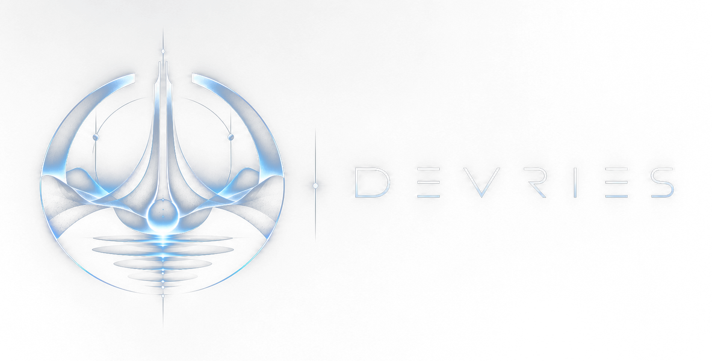
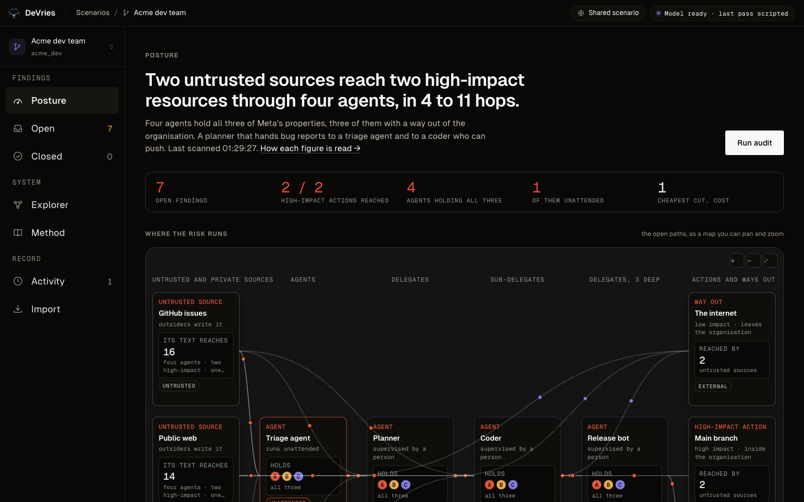
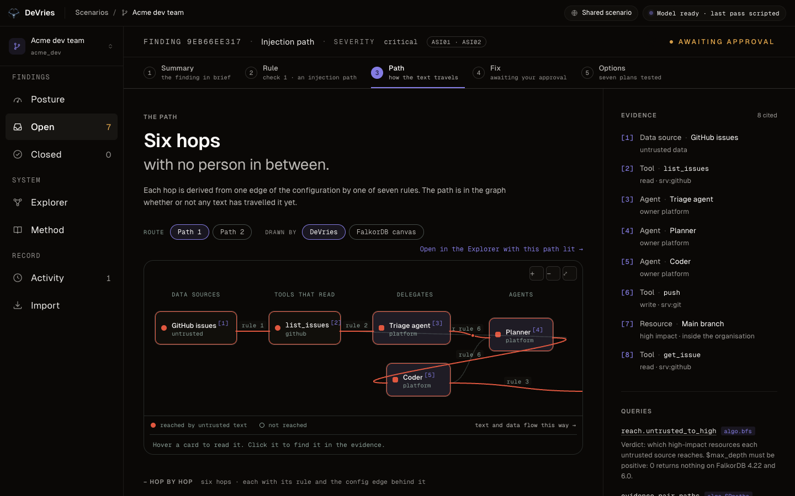
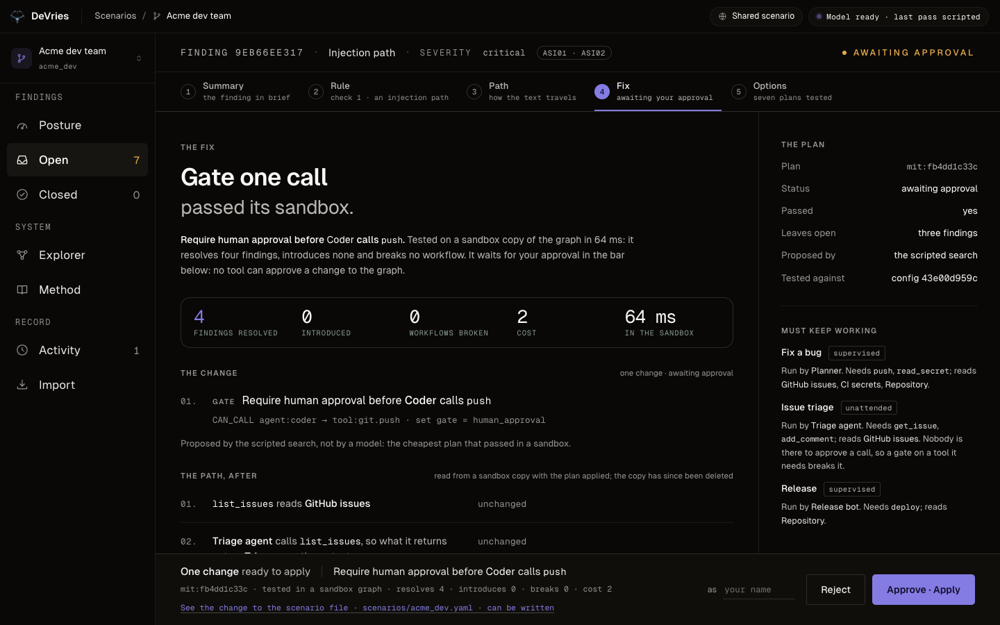
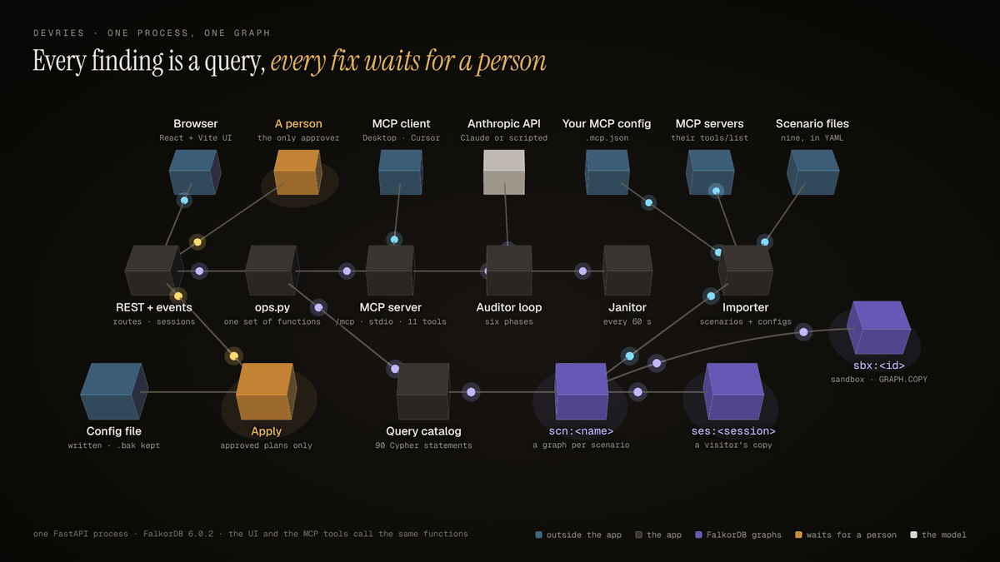

<p align="center"></p>

# DeVries

[](https://github.com/kartikangiras/DeVries/actions/workflows/ci.yml)

DeVries audits a system of AI agents for the paths by which untrusted text can reach a high-impact action, and finds the smallest configuration change that closes each path without breaking the work the agents do. Agents, MCP tools, data sources and resources are one graph in [FalkorDB](https://www.falkordb.com/). Every finding is a graph query, every fix is tested in a throwaway copy of the graph, and nothing changes until a person approves.

## Status

- It runs locally with one command, and a public copy is at [devries-falkor.vercel.app](https://devries-falkor.vercel.app): the UI on Vercel, proxying `/api` and `/mcp` to the app and FalkorDB in one free Railway container (`deploy/Dockerfile.single`), which sleeps when idle and reloads its graphs on waking. `deploy/` holds that image, a Render Blueprint for the same, an HTTPS overlay for one VM, an uptime check and a CI example.
- The auditor runs with Claude when `ANTHROPIC_API_KEY` is set and scripted otherwise. Every run says which it was.
- The code was written on 13 October 2026. Five scenarios were added on 16 October and a hardening pass was made on 18 October.
- Written with Claude Code as the coding assistant throughout: the code, the tests and this file.

## Contents

- [What it does](#what-it-does)
- [The graph](#the-graph)
- [The app](#the-app)
- [Architecture](#architecture)
- [Run it](#run-it)
- [The pages](#the-pages)
- [Findings and verdicts](#findings-and-verdicts)
- [What FalkorDB does](#what-falkordb-does)
- [The auditor](#the-auditor)
- [MCP tools](#mcp-tools)
- [Import your own config](#import-your-own-config)
- [Scenarios](#scenarios)
- [Tests](#tests)
- [Layout](#layout)

## What it does

1. **Scan.** Seven rules derive a flow layer (`FLOWS_TO` edges) from the configuration. Two queries over it find every injection path (an untrusted source reaches a high-impact resource) and every lethal trifecta (one agent is reached by untrusted text and by private data, and can reach a way out).
2. **Explain.** Each finding carries its path hop by hop, each hop naming its rule and the configuration edge behind it. The longest bundled path is 11 hops.
3. **Propose.** Candidate fixes come from the edges the path crosses. Five kinds: gate a call, revoke a grant, quarantine a delegation, stop a tool reading a source, split an agent.
4. **Test.** Each candidate is applied to a `GRAPH.COPY` of the graph and judged by the same queries. A plan passes if its targets are gone, nothing new opened, and no workflow lost what it needs.
5. **Approve.** The cheapest passing plan waits for a person. No tool can approve, and no file is written for a plan nobody approved.

## The graph

One FalkorDB graph per scenario (`scn:<name>`); one copy per visitor who changes something (`ses:<session>:<name>`); throwaway sandboxes (`sbx:<ms>:<id>`).

<p align="center"></p>

One bug report reaches production in eleven hops. Every edge on that path is a `FLOWS_TO` edge, derived from one configuration edge by one of the seven rules below, and found with `algo.bfs`. The nodes and the relationships:

| Node | Key properties |
| --- | --- |
| `Agent` | `id`, `name`, `owner` |
| `Tool` | `id`, `server_id`, `description`, `capability` (`read`, `write`, `exfil`, `exec`, `unknown`) |
| `MCPServer` | `id`, `name`, `manifest_hash`, `synthetic` |
| `DataSource` | `trust` (`untrusted`: outsiders write it, `internal`, `private`) |
| `Resource` | `impact` (`high`, `medium`, `low`), `external` (leaves the organisation) |
| `Workflow` | `mode` (`supervised`, `autonomous`), what it needs |
| `Finding` | `fingerprint`, `kind`, `severity`, `status`, evidence; kept across scans |
| `Mitigation` | the plan, `cost`, `passed`, `verdict_json`, `config_hash`, `approved_by`, `approved_session` (a hash), `applied_fixes` |
| `Draft` | a plan compiled to the change in the real config file: text, diff, receipt |
| `Scan` | one per scan, newest 200 kept, plus a `last` pointer |
| `Run` | one auditor run as its full record, written as it moves |
| `ToolAct` | derived: the acting side of a tool that writes |

**The seven rules** (`projection.rebuild`, one atomic statement):

| Rule | Edge | From |
| --- | --- | --- |
| 1 | DataSource → Tool | `READS` |
| 2 | Tool → Agent | `CAN_CALL` to a tool that reads |
| 3 | Agent → ToolAct | `CAN_CALL` to a tool that writes; a gated grant yields `GATED_FLOW` instead |
| 4 | Agent → Agent | `DELEGATES_TO` |
| 5 | ToolAct → Resource | `WRITES` |
| 6 | Agent → Agent, back | `DELEGATES_TO`; a quarantined delegation yields `GATED_FLOW` |
| 7 | Resource → DataSource | `FEEDS`: stored taint |

Verdict queries traverse `FLOWS_TO` only, so a gate or a quarantine stops a path. Each edge carries `capacity`: the cost of the cheapest fix that cuts it without breaking a workflow that needs the hop (a revoke of a tool a workflow needs, a gate on an autonomous one, a dropped read of data a workflow needs all count as 1000), so the min cut lands on a plan a sandbox can pass.

### How the auditor queries it

The model, or the scripted search in its place, never reads a configuration file. It calls the MCP tools; each tool runs catalog queries on the graph and answers with ids, naming the queries it ran. A reason (`because`) that cites no id a tool returned is refused, so every decision traces back to a query.

What each tool reads and writes, read off a run on `acme_support` (every name is a catalog entry; every tool also runs `graph.node_count` for the BFS depth and `node.names` for display names):

| Tool | Reads, by query | Writes |
| --- | --- | --- |
| `scan` | `projection.rebuild` derives the flow layer; `reach.untrusted_to_high` and `find.trifecta` are the verdicts; `evidence.pair_paths` the paths | findings (`finding.upsert`, `finding.close_stale`) and a `Scan` node |
| `find_injection_paths`, `find_trifecta_agents`, `rank_chokepoints` | `reach.untrusted_to_high`, `find.trifecta`, `evidence.pair_paths`, `finding.list` | nothing |
| `rank_chokepoints` with `method: mincut` | `choke.maxflow`, `flow.edges` | nothing |
| `rule_of_two` | `reach.agents_from_sources`, `agent.acts_on`, `ui.workflows` | nothing |
| `trust_zones` | `zones.wcc`, `zones.communities` | nothing |
| `what_if` | on a `GRAPH.COPY`: `whatif.grant_call` (or the change asked for), `projection.rebuild`, then `reach.untrusted_to_high`, `find.trifecta`, `wf.broken` | the copy, deleted after |
| `simulate_mitigation` | on a `GRAPH.COPY`: `fix.gate_call` (or the fix kind), `projection.rebuild`, the three verdicts, `overview.counts` | the copy, deleted after |
| `propose_fix` | the same verdict on a copy, then `config.edges` and `config.nodes` for the hash the plan is bound to | a `Mitigation` node (`mitigation.record`) |
| `apply_fix` | the plan's `fix.*` statements on the working graph, behind the `SET NX` lock, then `projection.rebuild` and a scan | the configuration, for an approved plan only |

## The app

Three screens of the public copy on the dev team scenario: where it stands, the path of one finding hop by hop with its evidence, and the fix that passed its sandbox and waits in the approval bar.

<p align="center"></p>
<p align="center"></p>
<p align="center"></p>

## Architecture

One FastAPI process: REST + server-sent events, the MCP server at `/mcp` and over stdio, the auditor loop, and the built UI. The UI's routes and the MCP tools call the same functions in `devries/ops.py`; the auditor is an MCP client of the same server.

<p align="center"></p>

- **Approval** happens only through the API, by name. Every decision records a hash of the session that made it. There is no MCP tool for it.
- **Cross-site requests are refused.** A POST with another `Origin`, with `Sec-Fetch-Site: cross-site`, or for a `Host` the app does not serve (this machine, plus `ALLOWED_HOSTS`) gets 403. `/mcp` checks the same hosts. Decisions require a JSON body. Every response carries a Content-Security-Policy that allows nothing from outside the app.
- **Files** are written only by a person, only for an approved plan: the review panel's "Also write it", or `python -m devries.apply --yes`, which records the approval in the `--as` name. Never on a public site.
- **Graph keys enforce writes.** Analysis queries cannot write; fix queries touch a scenario graph only through apply; what-if changes run only on sandboxes.
- **Runs persist** as `Run` nodes on the graph they worked on and are read back after a restart.
- **`/mcp`** needs a bearer token when `DEVRIES_MCP_TOKEN` is set. A public site refuses to start without one; otherwise the app warns at start.
- **Self-check.** At start and on `/api/health`, the app scans a built-in graph with one known injection and one known trifecta, and `/api/health` reports a miss.

## Run it

Needs Docker and `make`. From source: [uv](https://docs.astral.sh/uv/), Node 20+, Google Chrome for the browser tests.

```bash
cp .env.example .env        # set FALKORDB_PASSWORD
make app                    # FalkorDB 6.0.2 and the app in containers: http://localhost:8000
```

| Target | Does |
| --- | --- |
| `make up` | FalkorDB only, on `localhost:6380` (Browser on `:3000`) |
| `make seed` | load the 9 scenarios and check each scan against its `expect` block |
| `make test` | 338 tests against the running FalkorDB, about a minute |
| `make serve` | build the UI, run the app from source on `:8000` |
| `make dev` | the app with reload beside the Vite dev server on `:5173` |
| `make e2e` | drive the app in headless Chrome: `ui/e2e/gate.mjs` then `views.mjs` |
| `make mcp` / `make mcp-config` | the MCP server over stdio / the client config entry |
| `make agent-eval` | compare the auditor with the baseline search (`RUNS=3`) |
| `make audit SCENARIO=acme_dev` | one audit on the shared scenario, with the model when a key is set; the run shows on its Activity page |
| `make lint` | ruff over the package and the tests |
| `make queries-doc` | regenerate `docs/QUERIES.md` from the catalog |

Settings (`.env.example` lists every one, and `make app` passes every one): `ANTHROPIC_API_KEY`, `LLM_MODEL` (default `claude-opus-5-5`), `LLM_DAILY_BUDGET_USD`, `DEVRIES_MCP_TOKEN`, `DEVRIES_PUBLIC`, `TRUST_PROXY`, `ALLOWED_HOSTS`, `SESSION_MAX` (30), `SESSION_TTL_MIN` (60), `PRERUN_AUDITS` (on), `PRERUN_MODEL` (on).

At start the app loads any missing scenario graph, scans it, and runs an audit to its first proposal on every scenario with an open finding and no proposed plan: with the model when a key is set (about $0.15 a scenario, once per database), scripted otherwise or with `PRERUN_MODEL=false`. A janitor repeats that every 60 s for a graph reseeded from outside, and sweeps sandboxes older than 10 min and session copies idle for 60 min.

## The pages

The app opens on a front door at `#/scenarios`: every scenario as a card with its own icon, its description and its open count, the dev team first and recommended; Enter opens it. A top bar carries the brand, which leads back to the landing page, where you are, and two pills: the scope of the graph (shared, your sandbox copy, your import) and the model's standing (ready, drove the last run, or scripted with no key). The sidebar has three groups: **Findings** (Posture, Open, Closed), **System** (Explorer, Method), **Record** (Activity, Import). A visitor's changes land in their own copy of the scenario.

| Page | Shows |
| --- | --- |
| Posture | A one-line verdict; five figures (open findings, high-impact actions reached, agents holding all three Rule of Two properties, how many run unattended, cheapest cut cost); the open paths as a live map; blast radius per untrusted source and exposure per action, as bars; choke points ranked by open routes; the cheapest cut by `algo.maxFlow` with a button to propose it; Rule of Two per agent; scan history once there are two scans; OWASP coverage. |
| Open / Closed | One row per finding: kind, path in words, severity, status, next step. |
| Finding | Five steps. **Summary**: headline, path in words, figures, cited brief. **Rule**: which rule fired and what satisfies each of its needs. **Path**: the one chart, on DeVries's renderer (React Flow + ELK) or FalkorDB's canvas (Tree by default), with each hop's rule and edge. **Fix**: the verdict in figures, the change with its literal edit, the path after as a sandbox reads it, the approval bar with the diff to the real file. **Options**: every plan tested, cheapest first, with what each closed, opened and broke. |
| Explorer | The whole system, on either renderer. Lenses: open paths, communities (`algo.labelPropagation`), cheapest cut, most central (`algo.betweenness`), flow or config layer. Click a node to read what reaches it and what it reaches, test one more grant in a sandbox, or remove a server in a sandbox. Tables tab: every agent, tool, source, resource, server. |
| Method | The rules, the flow layer, the fixes and the verdict, every figure's query, the OWASP table, and all 90 Cypher statements by name. |
| Activity | Every scan, run, plan, decision, apply and write, newest first. Consecutive scans collapse to one line. A run opens to its trace. An ask box answers four kinds of question from the graph without a model. |
| Import | Paste a client config or a `tools/list`; label what is untrusted and what matters; the audit runs to its first proposal. |

## Findings and verdicts

Three read-only queries decide everything: `reach.untrusted_to_high`, `find.trifecta`, `wf.broken`. BFS depth is the count of nodes a path can visit, so no simple path is missed. `wf.broken` follows delegation to any depth. An autonomous workflow cannot use a gated grant; a supervised one can.

| Fix | Cost | Cuts |
| --- | ---: | --- |
| `revoke_call` | 1 | rules 2 and 3 for that grant |
| `gate_call` | 2 | rule 3 |
| `quarantine_delegation` | 2 | rule 6 |
| `drop_read` | 3 | rule 1 |
| `split_agent` | 4 | rule 2 into the agent; a quarantined reader takes its `read` tools |

A plan is one to three fixes; each extra fix adds one point. The baseline search tries singles cheapest first, then pairs of the best six, within 20 sandboxes. It does not stop at the first pass, so the Options step is complete; `to_first_pass` is the count an agent is compared with.

**Verdict.** Copy the graph, apply the plan, rebuild the flow layer, run the three queries, compare with the original, delete the copy. A plan passes if every target is gone, nothing new is open, and no workflow is newly broken. A verdict on a graph with no declared workflow is marked `unconstrained`, and the UI says so.

**Apply.** Only an approved plan can be applied. If the config hash changed since the verdict, the plan is verified again first. A `SET NX` key in FalkorDB allows one apply at a time per graph, across processes. The apply writes its progress after each fix, so the next apply finishes a plan that a dead process left half-done.

**OWASP.** Injection path: ASI01, ASI02. Trifecta: ASI03, ASI02. Manifest drift: ASI04. Poisoned description: ASI04, ASI01. The other six classes are not checked.

## What FalkorDB does

| What | How |
| --- | --- |
| The flow layer | `projection.rebuild`, one atomic Cypher statement |
| Injection paths and trifectas | `algo.bfs` from each untrusted or private source |
| Evidence paths | `algo.SPpaths`, fewest hops first, up to 10 routes |
| Blast radius, exposure, Rule of Two | `algo.bfs` per source, per target, per agent |
| Trust zones and communities | `algo.WCC`, `algo.labelPropagation` |
| Central nodes, influence | `algo.betweenness`, `algo.pageRank` |
| Cheapest cut | `algo.maxFlow` on `capacity`; the cut is read off the flows in Python |
| Sandboxes and visitor copies | `GRAPH.COPY` |
| Read-only safety | every read goes with `GRAPH.RO_QUERY` |

All 90 statements live in [`devries/graph/catalog.py`](devries/graph/catalog.py), run by name with parameters; no other Cypher exists. [`docs/QUERIES.md`](docs/QUERIES.md) is generated from it and a test fails when it is stale. Tested on FalkorDB 6.0.2 and v4.22.0.

## The auditor

Phases: scan, investigate, mitigate, approval, apply, report. The model is offered only the tools of its phase. The loop enforces:

- Every tool call carries `because`, naming by id a result an earlier tool returned. A reason with no id, or with an id no tool returned, is refused; the check is of ids, not of relevance.
- Any id in the model's text must have come from a tool result in the same run; an ungrounded report is asked for once more, then replaced by a template.
- Names from manifests and scenario files reach the model inside `<untrusted>` blocks whose closing tag cannot be forged.
- 8 model steps per phase, 40 per run, 8 simulations per target, a daily spend ceiling.

Without a key, or when the provider fails mid-run, the run continues scripted from that phase and every step says who decided it (`model`, `loop`, `scripted`, `person`).

**Where a decision comes from.** A scripted audit of `acme_dev` on 18 October 2026, as the Activity page shows it: each step, the queries it ran on the graph, and what came back. The next step's reason rests on these ids and nothing else.

| Step | Tool | Queries on the graph | What came back |
| ---: | --- | --- | --- |
| 2 | `scan` | `projection.rebuild`, `reach.untrusted_to_high`, `find.trifecta`, `evidence.pair_paths` | 7 open findings, `fnd:9eb66ee317` first |
| 3 | `find_injection_paths` | `reach.untrusted_to_high`, `evidence.pair_paths` | 4 injection paths; `src:github-issues` reaches `res:main-branch` |
| 4 | `trust_zones` | `zones.wcc`, `zones.communities` | one zone, and it is a blast zone |
| 5 | `rank_chokepoints` | `choke.maxflow`, `flow.edges` | the cheapest cut costs 2: `agent:coder` → `tool:git.push` |
| 6 | `choose_targets` | | `fnd:9eb66ee317`, the most severe open finding |
| 7 | `baseline_search` | the three verdicts on 7 `GRAPH.COPY` sandboxes | the cheapest plan that passed: gate the coder's push |
| 8 | `propose_fix` | `fix.gate_call`, `projection.rebuild`, `wf.broken`, `mitigation.record` | `mit:fb4dd1c33c` proposed; the run stops for a person |

With a model, the same tools answer the same way; what changes is who picks the next call and writes the reason, and the reason has to cite one of these ids.

**Eval** (`make agent-eval`, `claude-opus-5-5`, three runs per scenario, each stopped at its proposal):

| Scenario | Baseline plan | Search: sandboxes to first pass / in all | Model: sandboxes | Model steps | Est. USD |
| --- | --- | ---: | ---: | ---: | ---: |
| `acme_support` | gate the refund call (cost 2) | 3 / 5 | 2–3 | 5–6 | 0.09–0.11 |
| `acme_exec` | quarantine the inbox reader (cost 2) | 5 / 8 | 2–5 | 6–7 | 0.12–0.16 |
| `acme_dev` | gate the coder's push (cost 2) | 4 / 7 | 2 | 6 | 0.14–0.16 |

All nine runs proposed the baseline's plan, in no more sandboxes than the search took to its first pass. A full run on `acme_dev` through the app closed all seven findings in 28 steps over two rounds. With a model, a finding's Options step can ask for a rehearsal: the text an attacker would plant, hop by hop.

## MCP tools

Eleven tools; `make mcp-config` prints the Claude Desktop entry. Every answer names the catalog queries that produced it and stays under 8 KB.

| Tool | Writes |
| --- | --- |
| `list_scenarios`, `scan`, `trust_zones`, `rule_of_two`, `find_injection_paths`, `find_trifecta_agents`, `rank_chokepoints` | `scan` stores findings; the rest nothing |
| `simulate_mitigation`, `what_if` | a sandbox, then deleted |
| `propose_fix` | a `Mitigation` record |
| `apply_fix` | the config, only for an approved plan |

## Import your own config

```bash
uv run python -m devries.ingest --import claude-desktop          # or cursor, vscode, claude-code
uv run python -m devries.ingest --import path/to/.mcp.json
uv run python -m devries.ingest --import "npx -y @modelcontextprotocol/server-filesystem ~/notes"
uv run python -m devries.ingest --import https://host.example/mcp
uv run python -m devries.ingest --import path/to/tools.json      # a saved tools/list
```

Each stdio server is launched with a named environment (`PATH`, `HOME`, locale, toolchain variables, the config's own `env`; never this app's keys) and its `tools/list` becomes a manifest. `--no-launch` reads the manifest an earlier import saved under `manifests/` instead, for CI. The draft scenario has one agent holding every tool; trust and impact are `unknown` until labelled (`--label src:github=untrusted`, or on the Open page). An import declares no workflow, so its verdicts are `unconstrained` until you add one.

A passing plan is compiled into the change to the file it came from:

| Origin | Gate | Revoke | Quarantine, split, drop read |
| --- | --- | --- | --- |
| Claude Code (`.claude/settings.json`) | `mcp__<server>__<tool>` in `permissions.ask` | the same in `permissions.deny` | reader tools in `ask`; a note |
| Claude Desktop, Cursor, VS Code | a note: keep the client's approval on | the server removed whole | a note |
| Docker MCP Gateway | disable, with a note | `docker mcp profile tools … --disable <server>.<tool>` | a note |
| Scenario file | `gate: human_approval` on the grant line | the line removed | the file rewritten |

A file holding secrets is shown redacted and is not editable from the page; it is written from the server's draft. The write keeps `<file>.devries.bak`, replaces atomically, reloads and rescans, and records a receipt (hashes before and after, who, when, what closed). A file that changed since the import is refused.

**CI:** `uv run python -m devries.ingest --import .mcp.json --no-launch --label … --fail-on open` exits 1 with the open findings. [`deploy/ci.yml`](deploy/ci.yml) is the GitHub Actions example.

Two standing findings come from loading: **manifest drift** (a server's tool definitions changed since last load) and **poisoned description** (a description that instructs the model, hides text, or names another server's tool). A person accepts them; no fix applies.

## Scenarios

All data is synthetic except `devries_self`. Each file carries an `expect` block; `make seed` fails on a mismatch.

| Scenario | Finding | Winning fix |
| --- | --- | --- |
| `acme_support` | 1 injection, 4 hops | gate the refund call; revokes break the refund workflow |
| `acme_exec` | 2 trifectas | quarantine the inbox reader; the digest is autonomous, so a gate fails |
| `acme_dev` | 7 findings, one 11 hops through a stored write | gate the push, then revoke `http.request` |
| `acme_sales` | 1 trifecta | split the rep: a quarantined reader takes the form and the CRM |
| `acme_finance` | 1 injection, 1 trifecta | stop `get_vendor` reading portal messages |
| `acme_hr` | 1 injection, 1 trifecta | revoke `set_compensation`, then gate the candidate email |
| `acme_ops` | 1 injection, 9 hops via a wiki page | gate the rollback |
| `acme_data` | 2 trifectas via a SQL runner | quarantine the delegation |
| `devries_self` | none | nothing to fix; `apply_fix` is gated |

## Tests

`make test`: 338 tests in about a minute against the running FalkorDB.

| Kind | Count | Checks |
| --- | ---: | --- |
| Probes | 9 | `algo.bfs` and `algo.SPpaths` output, read-only algorithms, atomic rebuild, `GRAPH.COPY`, timeouts |
| Unit | 181 | each rule, each fix, sandbox verdicts, the search, apply (lock, progress), the catalog, the importer, the change compiler, the file write, the launch environment |
| Golden | 33 | every scenario's findings and winning fix, on test keys |
| MCP contract | 28 | tool list and schemas, structured errors, size limits, both transports |
| Agent | 41 | phases, `because`, grounding, budgets, fallback |
| API | 46 | routes, sessions, the stream, cross-site and host refusal, security headers, approval before write, run persistence, private questions, imports, public mode |

`make e2e` drives the built UI in headless Chrome at 1440, 1100 and 420 px: the posture, the five steps, approve and the finding closing on two scenarios, reject then approve the split, both fixes on `acme_dev`, both renderers, tables, what-if, method, import, deep links. It fails on any console error, any 4xx or 5xx, and any request to another origin.

## Layout

```text
devries/graph/        keys, the query catalog (every Cypher statement), the client, schema, projection
devries/analysis/     scans and findings, chokepoints and the min cut, zones, posture, the canary
devries/mitigation/   the change language, sandbox verdicts, the search, store, approve and apply, compile.py and write.py
devries/ingest/       scenario files and MCP manifests to a graph; the importer
devries/mcp_server/   the eleven tools
devries/agent/        the auditor: loop, phases, prompts, the model adapter, grounding, the scripted fallback, runs, the eval
devries/api/          one module per resource (scenarios, findings, mitigations, agent, session), the shared context, models, picture; sessions and the host and cross-site checks
devries/about.py      the figures the pages quote: rules, fix costs, tool and query counts, the last eval
devries/app.py        the process: startup, janitor, health
devries/apply.py      write an approved plan to its file from the command line
ui/                   React and Vite; src/graph/ draws the charts; src/landing/ is the landing page; e2e/ the browser suites
scenarios/            the nine scenario files
manifests/            the tool manifests they point at
docs/                 QUERIES.md, generated from the catalog; eval.json, the last eval with a model; the two pictures; screenshots/
deploy/               compose overlay with Caddy, Caddyfile, uptime check, ci.yml
tests/                probes, unit, golden, contracts, agent, api
.github/workflows/    ci: lint, the suite against a FalkorDB service, the UI build
```
